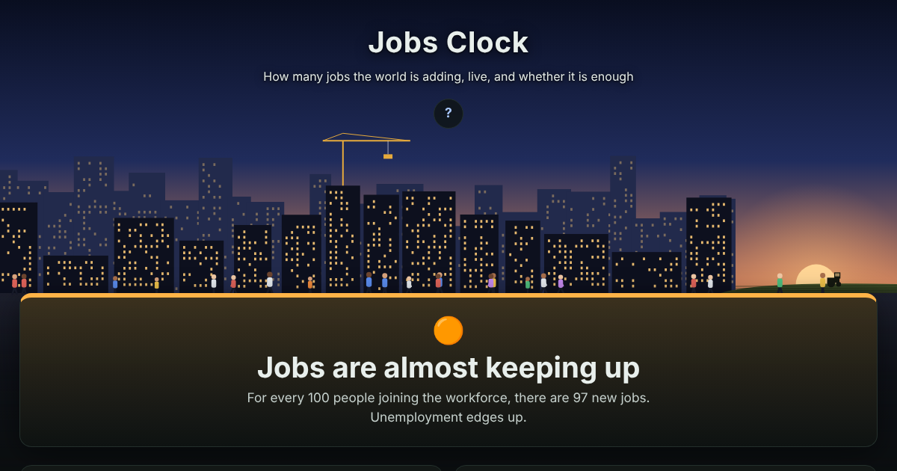

# Jobs Clock



**Live site: https://ramialbatal.github.io/jobs-clock/**

A static, real-time clock of **net new jobs** so far this year, next to the number of **unemployed people**, for the world and major economies.
It is part of the same series as the [Emissions Clock](https://ramialbatal.github.io/emissions-clock/) and the [Renewables Clock](https://ramialbatal.github.io/renewables-clock/).

**Languages:** English, French, Spanish and Arabic. The globe at the top switches language; `?lang=fr`, `?lang=es` or
`?lang=ar` opens one directly. Translations live in `js/i18n/`; corrections from native speakers are very welcome.

**On your own website:** the "Put this clock on your website" button at the bottom gives a one-line code for a small
live widget (the answer and the jobs counter), in the language you have open. The widget is the same page with
`?embed=1`.

## Data

On load, the page fetches three series from the [ILOSTAT API](https://ilostat.ilo.org/data/) (it allows cross-origin requests):
the ILO modelled estimates of employment, unemployment and the unemployment rate, ages 15+.
The ILO's latest edition includes its own estimates for the current and next year, so the page does not project the data itself.
Countries are configured in `js/config.js` (`X01` is the world, `X92` the EU-27).

## Method

Each yearly average is placed at the middle of its year, and the level at any moment is a straight line between neighbouring years.
Net new jobs so far = employment now minus employment on 1 January. Net means jobs gained minus jobs lost; no global source counts the gross churn.
This is a model, not a live measurement.

## Goal: are jobs keeping up?

New workers = growth in the labour force (employed plus unemployed) over the calendar year. The goal bar compares net new
jobs with new workers; at 100 or more per 100, unemployment falls. Countries with a shrinking workforce are judged on
whether unemployment is falling. A second check shows the direction of unemployment toward the UN's 2030 goal of full
employment (SDG target 8.5), which has no numeric target.

## Run it and check it

```sh
npm run serve        # then open http://localhost:8000
npm install          # dev tools only: TypeScript checker, Playwright, clock-core (types and tests)
npm run check        # house style + types + unit tests
npx playwright install chromium   # once, for the smoke test
npm run smoke        # real browser, real data, desktop and phone
```

Settings live in `js/config.js`, calculations in `js/model.js` (unit tested), page code in `js/app.js`, the picture behind the header in `js/scene.js`. Shared helpers
and styles come from [clock-core](https://github.com/ramialbatal/clock-core), pinned to an exact commit in `index.html` and `package.json`.
How the clocks are built, lessons learned and rules for new code: [developer notes](https://github.com/ramialbatal/clock-core/tree/main/docs).

## Contributing

Ideas, fixes and new data sources are welcome: see [CONTRIBUTING.md](CONTRIBUTING.md). Part of
[AI for things that matter](https://ramialbatal.github.io/), alongside the
[Emissions](https://github.com/ramialbatal/emissions-clock), [Renewables](https://github.com/ramialbatal/renewables-clock)
and [Jobs](https://github.com/ramialbatal/jobs-clock) clocks.

## Licence

Code: [MIT](LICENSE). Data is fetched live from its publishers and stays under their licences:

| Source | Used for | Licence |
|---|---|---|
| ILO, modelled estimates (ILOSTAT) | employment, unemployment, unemployment rate | CC BY 4.0 |
